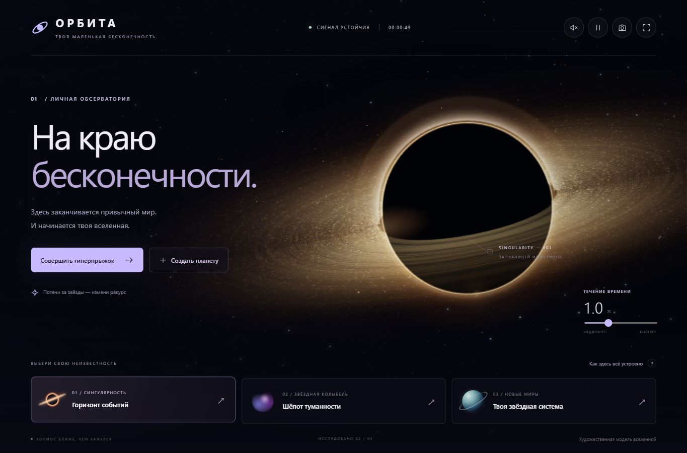

# Орбита

«Орбита» — интерактивная обсерватория в браузере. От горизонта событий можно совершить гиперпрыжок к туманности, а затем собрать собственную звёздную систему.

**[Открыть «Орбиту» в браузере](https://zxclunexxx.github.io/orbita/)**

## Запуск

Скачайте [ОРБИТА.html](ОРБИТА.html) и откройте файл в браузере. Стили, графика и звук уже внутри, так что приложение работает офлайн. Если вы скачали репозиторий целиком, версию с отдельными исходными файлами можно открыть через [index.html](index.html).

## Что попробовать

- Нажмите **«Создать планету»**. Дайте ей имя, выберите цвет и размер, добавьте кольца. В одной системе помещается до 12 авторских планет. Они сохраняются в этом браузере.
- Перетащите звёздное небо, чтобы изменить ракурс. Ползунок **«Течение времени»** меняет скорость движения от 0,1× до 3×.
- Нажмите кнопку с камерой, чтобы сохранить текущий вид как открытку в PNG.

| Клавиша | Действие |
| --- | --- |
| `1`, `2`, `3` | Горизонт событий, туманность, звёздная система |
| `H` | Совершить гиперпрыжок |
| `P` | Поставить движение на паузу или продолжить |
| `M` | Включить или выключить звук |
